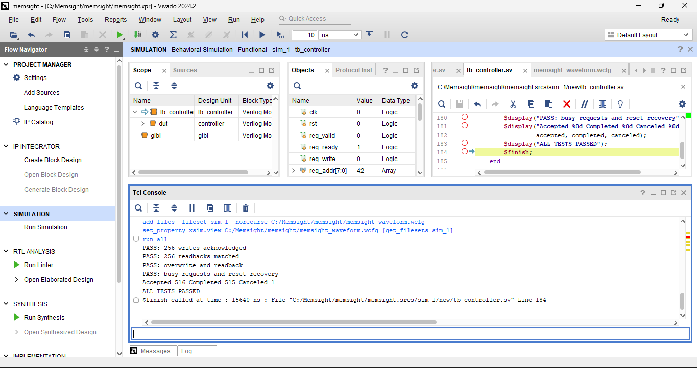
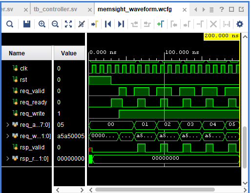

# MemSight
### Memory Controller Design and Verification

MemSight is a SystemVerilog memory-subsystem project exploring
memory-controller design, verification, and eventually scheduling
and performance trade-offs.

## Current milestone: single-bank controller

The first version implements a synchronous memory bank and a
controller that accepts read/write requests and returns responses.

- 256 × 32-bit words: 1 KiB of storage
- One clock domain
- One outstanding request
- Valid/ready request handshake
- Fixed two-cycle latency from acceptance to response
- One-cycle response-valid pulse
- Write acknowledgments with response data set to zero
- Active-high synchronous controller reset

The response interface has no backpressure. The receiver must
capture the response whenever rsp_valid is high.

## Architecture

| File | Purpose |
|---|---|
| rtl/memory_bank.sv | Synchronous single-port memory |
| rtl/controller.sv | Request handling and response state machine |
| tb/tb_controller.sv | Self-checking simulation testbench |

The controller uses three states:

1. IDLE: accept and latch a request.
2. EXECUTE: perform the memory operation.
3. RESPOND: return read data or acknowledge a write.

If a request is accepted at clock edge N, its response becomes
valid just after edge N + 2.

## Request protocol

A request is accepted on a rising clock edge when req_valid
and req_ready are both high.

The sender must hold req_valid and the request fields steady
while waiting for acceptance. After acceptance, it must withdraw
the request or present the next one.

Addresses identify 32-bit words, numbered 0 through 255.

## Reset behavior

Reset clears the controller state and response outputs.
It cancels an outstanding response but does not clear memory
or undo a write that has already occurred.

Memory is uninitialized at the start of simulation. Tests write
locations before reading them.

## Verification

Behavioral simulation passed in Vivado 2024.2 using its built-in
simulator.

The current testbench checks:

- Writes to all 256 addresses
- Readback of all 256 stored values
- Overwriting an existing value
- Two-cycle response timing
- Requests held while the controller is busy
- Cancellation of a pending read during reset
- No stale response after reset
- Preservation of previously written data across controller reset
- Request and response accounting

Observed result:

    PASS: 256 writes acknowledged
    PASS: 256 readbacks matched
    PASS: overwrite and readback
    PASS: busy requests and reset recovery
    Accepted=516 Completed=515 Canceled=1
    ALL TESTS PASSED

The canceled request is intentional and belongs to the reset test.
Simulation finished at 15,640 ns.

These are directed functional tests, not exhaustive verification.

## Run the simulation

1. Create an RTL project in Vivado.
2. Select the Basys 3 FPGA part: xc7a35tcpg236-1.
3. Add rtl/memory_bank.sv and rtl/controller.sv as design sources.
4. Add tb/tb_controller.sv as a simulation source.
5. Set tb_controller as the simulation top.
6. Select Run Simulation → Run Behavioral Simulation.
7. Enter `run all` in the Tcl Console.
8. Confirm that the console prints `ALL TESTS PASSED`.

## Simulation evidence

### Passing testbench


### Initial write transactions


## Scope and limitations

This milestone is a simulated single-bank memory controller.
It does not yet implement DRAM timing, refresh, multiple banks,
or a physical DDR interface.

Basys 3 is the intended FPGA target. Hardware operation,
resource utilization, and timing closure have not yet been
demonstrated.

## Planned development

- Request queue and four-bank memory organization
- Documented DRAM-style timing and refresh model
- C++ cycle-level reference model
- FIFO versus row-hit-priority scheduling
- Throughput, latency, and fairness measurements
- FPGA implementation and resource/timing reports
- UART-based hardware demonstration
## Automated simulation

In the Vivado Tcl Console, with no project open, run:

```tcl
source {C:/Memsight.memsight-repo/scripts/run_sim.tcl}
```

Adjust the path to match your repository location. The script creates a project under `build/` and runs the testbench.

Expected result:
```text
Accepted=516 Completed=515 Canceled=1
ALL TESTS PASSED
```